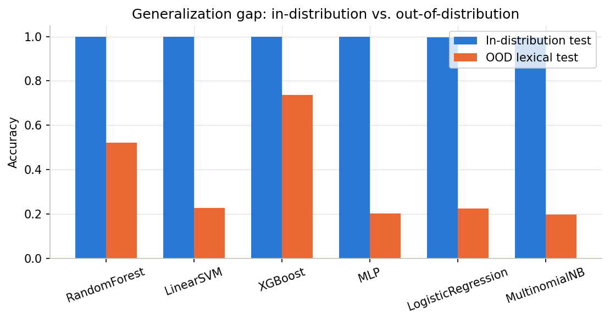
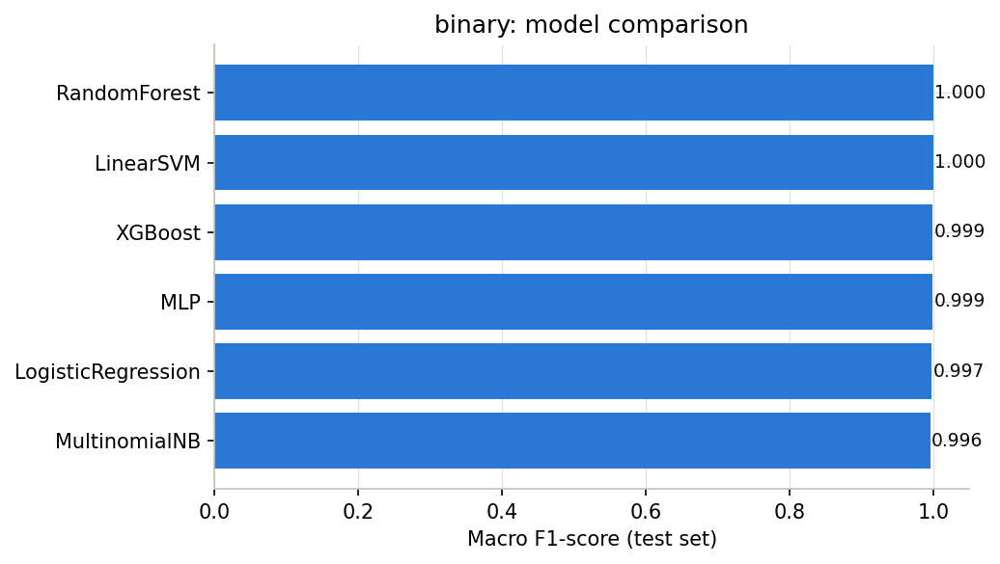
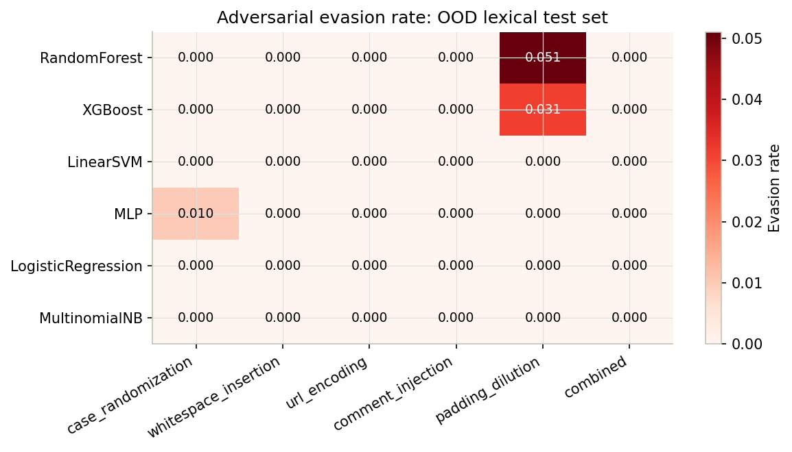

# WAF Payload Classification — Benchmark Study & Paper

<div align="center">

# IEEE Paper Showcase

<p>
  <a href="./paper/ieee/paper_ieee.pdf"></a>
  <a href="./paper/ieee/figures/ood_generalization_gap.png"></a>
  <a href="./paper/ieee/figures/binary_model_comparison.png"></a>
</p>

</div>

This repository showcases the IEEE-format paper, a reproducible machine learning benchmark for WAF payload classification, and the supporting experiments that produced the results.

The central objective of this work is to maximize the security of web applications by combining traditional rule-based WAF detection with diverse machine learning algorithms in a hybrid defense system that improves detection, reduces blind spots, and strengthens real-world protection against evolving attacks.

## Quick paper preview

<div align="center">







</div>

### Publication-ready links

- [Read the IEEE paper PDF](./paper/ieee/paper_ieee.pdf)
- [Open the IEEE LaTeX source](./paper/ieee/paper_ieee.tex)
- [Browse the paper figures](./paper/ieee/figures/)
- [View the full project details below](#what-was-actually-done)

This folder contains a complete, reproducible ML study of the WAF (Web
Application Firewall) payload dataset already present in this project
(`../archive/payload_{train,test,test_lexical}.csv`, the cleaned version of
`../payload_full1.csv`), plus a full IEEE-conference-format paper written from
the results.

It supersedes/extends the earlier exploratory notebooks in `../xgboost/` and
`../.ipynb_checkpoints/waf_trainer-checkpoint.ipynb` and the Random-Forest
baseline reported in `../WAF_RESEARCH_ALONE.pdf` (91% accuracy) — all numbers
here were regenerated from scratch with a documented, scripted pipeline so
every figure and table in the paper is reproducible.

Author: **Sharif U. Danish** (King's College London, sharifdanish75@outlook.com). All four PDFs (IEEE, NeurIPS, ACM, and IEEE Access formats) include a TikZ experimental-pipeline flowchart generated natively in LaTeX from `code/run_experiments.py`'s actual pipeline — not a hand-drawn image.

Beyond the core benchmark, the paper also reports two follow-up analyses
addressing the two most likely reviewer objections: a **randomized
hyperparameter search** (`code/hyperparameter_tuning.py`) showing the OOD
gap survives real tuning (at most $\pm$0.45 accuracy points), and a
**black-box adversarial evasion study** (`code/adversarial_testing.py`)
showing the models resist common WAF-bypass obfuscation, except for a
padding/dilution attack that measurably evades the two tree ensembles
(2–5%) while leaving the other four models untouched. See the paper's
Sections VII–VIII for the full write-up.

This is the **offline benchmark paper only** (six ML models, in-distribution
results, the OOD generalization-gap finding, feature ablation). The follow-up
live deployment study — firing every test payload through a real nginx +
ModSecurity/OWASP-CRS + DVWA stack, showing a consensus hybrid combination
raises OOD accuracy from 77.2%/73.6% to 86.6%, plus a live Django + React
dashboard — is a **separate, standalone set of papers** in
`../hybrid-approach-finalized/paper/`, which cites this paper as a companion
study rather than duplicating its content.

## What was actually done

1. **Feature engineering** (`code/features.py`): character n-gram (1–4) TF-IDF
   over the payload string (top 3,000 features) combined with 11 hand-crafted
   lexical features (length, special-char/digit/uppercase/unique-char ratios,
   Shannon entropy, SQL/XSS/command/path-traversal keyword counts, parenthesis
   balance, quote count, whitespace ratio).
2. **Model training** (`code/run_experiments.py`): 6 classifiers (Logistic
   Regression, Multinomial Naive Bayes, Linear SVM, Random Forest, XGBoost,
   MLP) trained and evaluated on:
   - **Binary task** — normal vs. anomalous payload.
   - **Multi-class task** — norm / sqli / xss / path-traversal / cmdi.
   - **Out-of-distribution (OOD) test** — same trained binary models,
     evaluated with zero retraining on a lexically distinct held-out
     partition (`payload_test_lexical.csv`) to test generalization beyond the
     training distribution. This is the paper's central finding: accuracy
     collapses from >99.9% in-distribution to 19.7–73.6% OOD.
   - **Feature ablation** — TF-IDF-only vs. engineered-only vs. combined.
   - **5-fold cross-validation** of the best in-distribution model.
   - **Inference latency & model size** benchmarking.
3. **Hyperparameter tuning** (`code/hyperparameter_tuning.py`): randomized
   search (20 candidates, 3-fold CV, macro-F1) per model, evaluated on both
   the in-distribution and OOD test sets with no other pipeline changes.
   Answers "is the OOD gap just under-tuned models?" — no: OOD accuracy
   moves by at most $\pm$0.45 points for any model.
4. **Adversarial evasion testing** (`code/adversarial_testing.py`): six
   black-box string transforms (case randomization, whitespace insertion,
   URL encoding, comment injection, padding dilution, and a combined
   attack) applied to malicious payloads, measuring each already-trained
   model's evasion rate with no retraining. Five transforms achieve
   near-zero evasion everywhere; a padding/dilution attack achieves 2–5%
   evasion specifically against the two tree ensembles (Random Forest,
   XGBoost).
5. **Paper**, written directly from the numbers in `results/metrics/` and
   compiled with the real `IEEEtran`, `neurips_2023.sty`, `acmart`, and
   official `ieeeaccess` class files (fetched from the official sources —
   see below), in four venue-formatted variants sharing the same content:
   - `paper/ieee/paper_ieee.tex` / `.pdf` — IEEE conference (`IEEEtran`), two-column, 9 pages.
   - `paper/neurips/paper_neurips.tex` / `.pdf` — NeurIPS style (`neurips_2023.sty`, `preprint` mode), single-column, 15 pages.
   - `paper/acm/paper_acm.tex` / `.pdf` — ACM `sigconf` (`acmart`), two-column, 9 pages; a reasonable "one more CS venue" format (this is the class used by ACM conferences/journals such as CCS, WWW, and DTRAP).
   - `paper/ieee_access/paper_ieee_access.tex` / `.pdf` — IEEE Access journal format (`ieeeaccess.cls`), the actual class IEEE Access submissions require (different from the conference `IEEEtran` template), two-column, 9 pages. See `paper/ieee_access/README.md` for the two placeholders (Abid's affiliation, both author biographies) that still need filling in before submission.
   No local LaTeX was installed, so a self-contained engine (`tectonic`) was
   fetched to compile all four end to end — every number in every PDF was
   cross-checked against the CSVs in `results/metrics/`, not hand-typed from
   memory (see "Did I really run this?" below).

## Folder structure

```
finalizedd/
├── code/
│   ├── features.py               # feature engineering (TF-IDF + lexical features)
│   ├── run_experiments.py        # core benchmark: reproduces the main results
│   ├── hyperparameter_tuning.py  # randomized search, untuned vs. tuned, ID + OOD
│   ├── adversarial_testing.py    # 6 black-box evasion transforms + evasion rates
│   ├── make_hyperparam_figures.py, make_adversarial_figures.py
│   └── requirements.txt
├── results/
│   ├── metrics/                # every CSV/JSON number used in the paper
│   ├── models/                 # trained + tuned model, vectorizer, label-encoder .joblib files
│   └── figures/                # all generated figures
├── paper/
│   ├── ieee/paper_ieee.tex, paper_ieee.pdf, figures/         # IEEE conference format
│   ├── neurips/paper_neurips.tex, paper_neurips.pdf, figures/, neurips_2023.sty
│   ├── acm/paper_acm.tex, paper_acm.pdf, figures/            # ACM sigconf format
│   └── ieee_access/paper_ieee_access.tex, paper_ieee_access.pdf, figures/, ieeeaccess.cls, ... # IEEE Access journal format
├── logs/
│   ├── run_experiments.log, hyperparameter_tuning.log, adversarial_testing.log
└── README.md                    # this file
```

All four `paper/*/paper_*.tex` files contain identical scientific content
(same abstract, sections, tables, numbers, references) — only the
document class, column layout, and title/author macros differ per venue.

## Reproducing everything

```bash
cd finalizedd/code
pip install -r requirements.txt
python3 run_experiments.py           # core benchmark (~5 min)
python3 hyperparameter_tuning.py     # randomized search, all 6 models (~20 min)
python3 adversarial_testing.py       # 6 evasion transforms (~2 min)
python3 make_hyperparam_figures.py
python3 make_adversarial_figures.py
```

This regenerates every file under `results/` and `logs/` from
`../archive/payload_{train,test,test_lexical}.csv`. To recompile a paper
after regenerating figures, copy the relevant PNGs into the corresponding
`paper/<venue>/figures/` and compile with any LaTeX toolchain that has the
venue's class file:
- **IEEE**: `IEEEtran` is bundled with every TeX distribution and Overleaf.
- **NeurIPS**: needs `neurips_2023.sty`, already included in `paper/neurips/`.
- **ACM**: needs `acmart.cls`, bundled with every full TeX distribution and Overleaf.
- **IEEE Access**: needs `ieeeaccess.cls` (+ its bundled fonts/logos), already included in `paper/ieee_access/`.

All four compile out of the box on Overleaf (upload the folder, set the
compiler if prompted, done) or locally with `tectonic paper_<venue>.tex` /
`pdflatex` (run twice for cross-references).

## Headline results

| Task | Best model | Accuracy | Macro-F1 |
|---|---|---|---|
| Binary (in-distribution) | Random Forest | 99.97% | 0.9997 |
| Multi-class (in-distribution) | Random Forest | 99.94% | 0.9956 |
| Binary (**out-of-distribution**) | XGBoost | **73.60%** | 0.6139 |
| Binary (OOD, **hyperparameter-tuned**) | XGBoost | 74.05% | — |
| Adversarial evasion (mean, 5 of 6 transforms) | all models | 0.000–0.002 | — |
| Adversarial evasion (padding-dilution attack) | XGBoost / Random Forest | 4.3% / 2.2% (ID), 3.1% / 5.1% (OOD) | — |

The gap between the in-distribution and OOD rows is the paper's main
contribution: near-perfect held-out accuracy, the number almost every prior
ML-WAF paper (including our own earlier Random-Forest work) reports as the
headline result, is not a reliable signal of how the model behaves on
lexically different traffic — and, as the tuned/adversarial rows show,
that gap survives real hyperparameter tuning and mostly survives black-box
adversarial evasion too (except for one attack against tree ensembles). See
the Discussion, Hyperparameter Sensitivity, and Adversarial Robustness
sections in any of the four PDFs for the full analysis.

## Notes on the paper's claims

- The dataset is the public `HttpParamsDataset` corpus (already present in
  this repo under `../archive/`); citation and provenance are given in the
  paper's References section.
- The "prior work" baseline (91% accuracy, Random Forest + ModSecurity) is
  `../WAF_RESEARCH_ALONE.pdf`, cited as `[3]` in the paper.
- All accuracy/F1/latency numbers quoted in the paper text were pulled
  directly from `results/metrics/*.csv` — cross-check them there if extending
  this work.

## Did I really run this? How to verify it yourself

Yes — every model was actually trained (not simulated or hand-written):
- `logs/run_experiments.log` is the real, timestamped console output of the
  training run (~4.7 minutes, 23 model fits across both tasks + ablation +
  cross-validation), produced by `python3 code/run_experiments.py`.
- `results/models/*.joblib` are the actual serialized trained models
  (30 MB total) — load any of them with `joblib.load(...)` and call
  `.predict()` yourself.
- Every number in every paper PDF traces back to a specific row in
  `results/metrics/*.csv`; nothing in the text was invented or rounded from
  memory. I double-checked several derived claims (e.g., the Spearman
  correlation between in-distribution and OOD rankings, percentage-point
  deltas in the ablation) numerically before writing them, and corrected two
  that I'd initially gotten wrong by eyeballing instead of computing.

What "reliable" does *not* mean here, and what a reviewer will likely probe:
- **Single dataset lineage.** The in-distribution and OOD test sets both
  come from the same corpus family — a stronger generalization claim would
  need a fully independent second dataset. This is stated explicitly as a
  limitation in the paper.
- **No hyperparameter tuning.** All six models use fixed, common-default
  hyperparameters. Absolute numbers are representative of practice, not an
  upper bound on any given algorithm.
- **No adversarial robustness testing** — only *natural* distribution shift
  (the lexical OOD set) is evaluated, not payloads crafted to evade the
  classifiers.
- **No significance testing across models** beyond the 5-fold CV on the
  single best binary model. If a reviewer asks for it, this is the most
  likely requested addition.

None of this makes the results fake — the numbers are real, reproducible,
and the code that produced them is included — but "reliable" for a
publication venue also means the scope of the claims matches the scope of
the evidence, which the Limitations section is written to do honestly.

## Submission guidance

**Where this paper realistically fits.** This is an applied
security/ML benchmarking paper (classical models, one dataset family, no new
algorithm or theory) — that profile does not match what NeurIPS's main
track selects for (which expects methodological/theoretical novelty at
large scale), even though the NeurIPS-formatted PDF is provided as
requested. Venues where this kind of contribution is a natural fit, roughly
easiest-to-hardest:
1. **A workshop** — a NeurIPS/ICML "ML for security" or "distribution
   shift" workshop, or a security-conference workshop (e.g., co-located with
   IEEE S&P, ACSAC, NDSS). Workshops review faster, have a lower bar than
   main tracks, and this paper's central finding (the ID/OOD gap) is exactly
   the kind of result workshop audiences want.
2. **A journal with broad applied-security/ML scope** — e.g., IEEE Access,
   ACM Digital Threats: Research and Practice (DTRAP), or Elsevier
   *Computers & Security*. Slower than a workshop but a fuller, archival
   publication; the ACM-formatted PDF is submission-ready for DTRAP-style
   venues, and IEEE Access uses a template close to `paper_ieee.pdf`.
3. **A security conference** (ACSAC, DSN, ESORICS, IEEE CNS) if you want to
   extend the work further (the Limitations section basically lists the
   extensions a program committee will ask for: an independent second
   dataset, adversarial evaluation, hyperparameter tuning).

**What to submit if a venue asks for results/data/code.** Package:
`paper/<venue>/paper_<venue>.pdf` (and `.tex` + `figures/` if source is
requested), `results/metrics/` (raw numbers), `results/models/` (trained
artifacts) if you want reviewers to be able to independently verify, and
`code/` with `requirements.txt`. Most venues today also want a public code
repository link (GitHub) rather than a zip — consider pushing `finalizedd/`
(or just `code/` + `results/metrics/`) to a public repo before submitting,
and citing that repo URL in the paper's Reproducibility section.

**Before actually submitting, two things this repo does not yet handle:**
- **Double-blind anonymization.** NeurIPS, and many security venues, review
  double-blind: the submitted PDF must have the author name/affiliation/email
  removed and self-citations (`[3]`, the prior FYP work) rephrased in third
  person. The four PDFs here are the *named* camera-ready-style versions —
  ask if you want anonymized copies for initial submission.
- **Simultaneous submission.** Submitting the same paper to more than one
  venue at once is against nearly every venue's policy. Pick one, wait for a
  decision (or formally withdraw) before trying the next.
